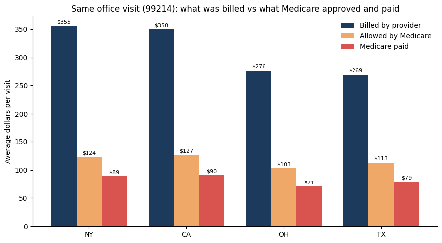

# Medicare Cost Variation Analysis

Why does the exact same doctor visit cost so differently from one provider to another? A real-data analysis of Medicare billing patterns across four US states.

## The problem

I'm approaching this as a data analyst on a health insurance cost and oversight team. The question: for the exact same service, why do costs look so different across providers and states, and where should oversight focus its limited time?

To keep the comparison fair, I picked one single service HCPCS code **99214**, a standard 30-minute office visit for an existing patient and compared four large states: **California, New York, Texas, and Ohio**.

## Data source

**CMS Medicare Physician & Other Practitioners — by Provider and Service (2024)**, from [data.cms.gov](https://data.cms.gov/provider-summary-by-type-of-service/medicare-physician-other-practitioners/medicare-physician-other-practitioners-by-provider-and-service). Real, public government data, 131,951 provider records after filtering to code 99214 across the four states.

## Steps I took

1. Filtered the CMS data explorer to code 99214 across CA, NY, TX, and OH, and exported the CSV.
2. Loaded the data into Google Colab (built entirely on a phone, no laptop involved).
3. Checked the data before trusting it confirmed only the four states and one code were present, checked for duplicates (none found), and identified 3 rows where Medicare paid $0, which I removed as a data oddity.
4. Loaded the clean data into SQLite and queried it directly.
5. Flagged "extreme billers" providers billing more than 5x the Medicare-approved price — limited to providers with at least 30 patients to avoid small-sample noise.
6. Checked whether extreme billers were spread out or concentrated around a few repeated price points.
7. Charted the results in Python (matplotlib).
8. Built a dashboard in Looker Studio.

## Key SQL queries

```sql
-- Compare billed, allowed, and paid amounts by state
SELECT state,
       COUNT(DISTINCT npi) AS providers,
       ROUND(AVG(billed), 2) AS avg_billed,
       ROUND(AVG(allowed), 2) AS avg_allowed,
       ROUND(AVG(paid), 2) AS avg_paid,
       ROUND(AVG(billed) / AVG(allowed), 2) AS billed_to_allowed
FROM visits
GROUP BY state
ORDER BY avg_billed DESC;
```

```sql
-- Flag providers billing more than 5x the Medicare-approved price
SELECT state,
       COUNT(*) AS provider_rows,
       SUM(CASE WHEN billed_to_allowed > 5 THEN 1 ELSE 0 END) AS extreme_billers,
       ROUND(100.0 * SUM(CASE WHEN billed_to_allowed > 5 THEN 1 ELSE 0 END) / COUNT(*), 2) AS pct_extreme
FROM visits
WHERE patients >= 30
GROUP BY state
ORDER BY pct_extreme DESC;
```

```sql
-- Check whether extreme billers share the same billed price
-- (a repeated price points to one organisation's price list, not many individual providers)
SELECT state,
       ROUND(billed, 0) AS billed_price,
       COUNT(*) AS provider_rows
FROM visits
WHERE patients >= 30 AND billed_to_allowed > 5
GROUP BY state, ROUND(billed, 0);
```

## What I found



| State | Avg. billed | Avg. Medicare-approved | Avg. Medicare paid |
|---|---|---|---|
| New York | $355 | $124 | $89 |
| California | $350 | $127 | $90 |
| Ohio | $276 | $103 | $71 |
| Texas | $269 | $113 | $79 |

- **Providers bill about 2.7x what Medicare approves**: roughly $317 billed against $118 approved, for the exact same visit.
- **New York bills the most, Texas the least** : a 32% gap for the exact same visit. But most of that gap isn't the care itself: the Medicare-approved amount differs by only ~23% between the highest and lowest state, and after removing local cost-of-living adjustments, that gap shrinks to ~10%. The bigger difference is in what providers choose to bill.
- **Setting matters**: Medicare pays about $86 for an office visit versus $68 for the same visit in a hospital facility.
- **The headline finding:** about 6.8% of providers (with 30+ patients) billed more than 5x the Medicare-approved price. Ohio had the *lowest* average bill of the four states, but the *highest* share of extreme billers (~14%). And 87% of those Ohio extreme billers charged the exact same price, $624. In California, 43% of extreme billers charged $858. This points to a small number of organizations using a standard price list not thousands of individual doctors independently deciding to overcharge.
- Cancer-related specialties (medical oncology, radiation oncology, hematology) billed furthest above the Medicare-approved price of any provider type.

## What I'd recommend

1. **Focus oversight on the extreme-billing tail**, not on all providers it's cheaper and more useful than a broad audit.
2. **Compare providers only within the same state and setting** local pricing and office-vs-facility rules already explain part of the gap, so comparing across them isn't a fair test.
3. **Use the billed-to-allowed ratio as a simple, repeatable screening flag**, tracked yearly.

## Limits of this analysis

- **Billed is not paid.** Medicare pays its approved amount regardless of what's billed
   a high billed price does not by itself mean Medicare overpaid.
- **Only four states and one procedure.** Can't be generalized to the whole US or other visit types.
- **Medicare data only**  may not reflect private insurance.
- **A high bill is a reason to look closer, not proof of wrongdoing.**

## Tools used

Python (pandas), SQL (SQLite), Google Colab, Looker Studio, Notion

## Links

- Live dashboard: https://datastudio.google.com/reporting/dd2c6b43-7db1-4050-935d-a2c7c34c4ee9
- Case study write-up: https://app.notion.com/p/Medicare-Cost-Variation-Analysis-3e9cd905012f8164bd9ef724c1e31479?source=copy_link
- Notebook: `medicare_cost_variation_analysis.ipynb` (in this repo)

---
*Data source: Centers for Medicare & Medicaid Services (CMS), Medicare Physician & Other Practitioners by Provider and Service, 2024.*
```
